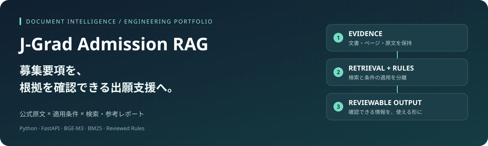
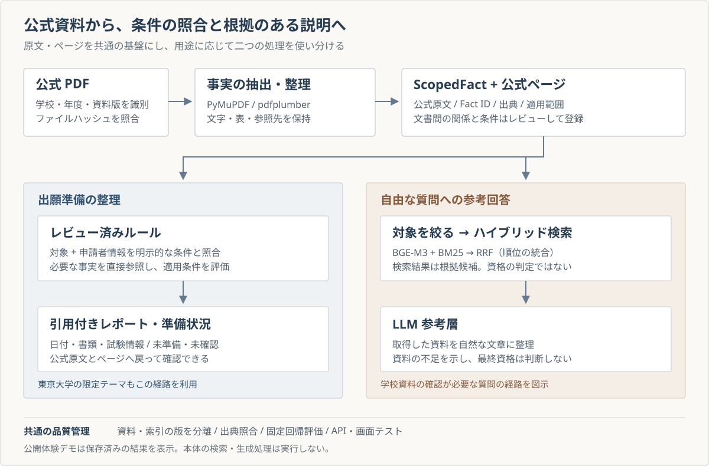

  

  
  
  
  
  

# J-Grad Admission RAG

**日本の大学院募集要項を、教務担当者が根拠を確認しながら使える出願支援情報に整理するシステムです。**

> An evidence-grounded assistant for Japanese graduate admissions.  
> Built for teachers and academic advisers who repeatedly check requirements across official documents.  
> Combines BGE-M3 + BM25 retrieval with reviewed rules; LLM answers remain a reference layer.  
> Covers a fixed Science Tokyo guideline and five document topics for one University of Tokyo program.  
> Saved evaluation (2026-09-24): 42 fixed queries, 391 KB entries, hybrid Recall@10 **0.8852** / MRR **0.8323**.  
> [Try the interactive demo](https://yasu-isct.github.io/J-Grad-Admission-RAG/) — saved scenarios, Japanese by default, Chinese available.

**[▶ デモを試す](https://yasu-isct.github.io/J-Grad-Admission-RAG/)** · [画面](#画面で見る) · [設計](#設計と処理の流れ) · [評価](#評価結果とその読み方) · [技術解説](docs/portfolio/engineering-ja.md)

留学塾の教務現場へのデモとフィードバックをもとに開発しました。研究科共通の要項と専攻別資料を往復して調べる作業を、**対象選択 → 要点確認 → 準備状況との照合 → レポート作成**にまとめています。

2026年10月24日時点の公開作品集です。機能は実装済みの範囲を下記に示し、追加開発とバックエンドの公開運用は保留しています。ブラウザの体験デモは保存済みサンプルを使うため、インストール不要で操作できます。自由入力の検索・AI回答は本体の機能で、公開デモでは実行しません。

## 画面で見る

**複数資料の関係から、公式原文へ。** 東京大学の英語スコア証明を例に、共通要項・専攻案内・追加提出物一覧の役割を一つの画面で確認できます。

<table>
<tr>
<td width="65%" valign="top">
<strong>準備状況と、次にすること</strong> 
 
公式の提出条件と本人の自己申告を分けて表示します。
</td>
<td width="35%" valign="top">
<strong>必要な情報を持ち帰る</strong> 
 
選んだテーマの参考レポートをプレビュー・コピーできます。
</td>
</tr>
</table>

画像は2026年10月21日の日本語版公開デモです。[画面と出所](docs/portfolio/screenshots-ja.md) · [デモの収録範囲](docs/portfolio/interactive-demo-ja.md)

## 実装済みの範囲

| 対象 | 利用できる機能 | 対応範囲 |
| --- | --- | --- |
| 東京科学大学・修士 | 出願日程、共通書類、個人条件との照合、試験情報、RAG参考質問、レポート | 固定版「2027年4月／2026年9月入学」。試験表示は選択可能な18系・2入学時期。別冊の地球生命コース等は対象外 |
| 東京大学・新領域・複雑理工学専攻（CBMS） | 複数資料の根拠表示、条件照合、準備状況、レポート | 2027年度修士・一般選抜A・2027年4月入学。英語成績表、チェックリスト自体、学業と職務の両立計画書、小論文、志望調査票の5テーマ |

東大全専攻・全書類・自由な東大横断RAG検索には未対応です。過去の固定資料を使い、現在の募集受付や学校の最終的な出願資格・受理・合否を判定するものではありません。

## 設計と処理の流れ

- **事実を保管する。** `ScopedFact`に公式原文とPDFページを保持。学校・研究科・専攻・年度・入学時期・選抜ルート・資料版を識別します。
- **検索と判定を分ける。** BGE-M3とBM25を順位ベースのRRFで統合。検索は根拠候補を返し、条件の適用は本人情報とレビュー済みルールで評価します。構造化表示は必要なFactを直接参照でき、毎回の類似検索を必要としません。
- **説明を追跡可能にする。** 引用と文書間の関係を保存し、原文へ戻れるようにします。LLMは参考回答を整理し、資格の確定や未確認の条件の補完は担いません。
- **資産を再利用する。** 索引はNumPyのローカル成果物。モデル版・次元・KBとの対応を検証して読み取り専用で再利用し、回帰用と製品用の索引を分離します。

[設計判断とトレードオフ](docs/portfolio/engineering-ja.md) · [詳細アーキテクチャ](docs/architecture.md)

## 評価結果とその読み方

**固定42問・391件のKB、2026-09-24保存レポート。** 東京科学大学の同一資料に対する日本語・中国語の検索評価です。下表の「未測」は、この同じ評価集合で比較できる保存結果がないことを示します。

| 検索方式 | Recall@10 | MRR | 保存結果 |
| --- | ---: | ---: | --- |
| BM25単独 | 未測 | 未測 | 同一42問での記録なし |
| ベクトル単独（BGE-M3） | 未測 | 未測 | 同一42問での記録なし |
| ハイブリッド（BGE-M3 + BM25 / RRF） | **0.8852** | **0.8323** | [原レポート](tests/fixtures/grounded_rag_retrieval_report_v1.json) / [評価説明](docs/evaluation/grounded-rag-release-v1.md) |

Recall@10は「正解と注釈した根拠のうち、上位10件に含まれる割合」の質問ごとの平均、MRRは「最初の正解根拠の順位の逆数」の平均です。回答の正解率を示す値ではありません。[指標の定義](docs/evaluation/retrieval-evaluation-v1.md)

- **Release-subset MRR 0.2455：** 同じリリース評価内の11件のサービス経由ケース（難しい中国語・回答拒否ケースを含む）の実際の検索順位から算出した値で、42問全体のMRRとは対象も実行条件も異なります。
- **中国語→日本語 hit@10 0.50：** リリース評価内の対象となる中国語質問で、日本語の正解根拠が上位10件に一つ以上入った割合です。全質問のRecall@10や翻訳品質ではありません。

[部分集合の定義](docs/evaluation/grounded-rag-release-v1.md) / [保存された評価結果](tests/fixtures/grounded_rag_evaluation_report_v1.json)。[以前のBM25検証](docs/evaluation/lexical-retrieval.md)は別の34問・298件を対象としたヒット件数の記録なので、この表のRecallやMRRに置き換えていません。現時点ではハイブリッドが単独方式より優れるという比較結論は出していません。

## コード品質を確認する

| 観点 | 確認方法 |
| --- | --- |
| 入出力・対象の整合性 | Pydantic契約、資料ID・ハッシュ照合。欠けた根拠や対象の不一致を拒否 |
| 自動チェック | [Quality CI](.github/workflows/quality.yml)：pytest、Ruff、構文確認、保存済み検索・引用基準の回帰チェック |
| 条件と検索のテスト | [条件の適用](tests/test_applicability.py)、[複数文書検索](tests/test_corpus_search.py)、[キーワード検索](tests/test_lexical_search.py) |
| 資料追加の再現性 | [設定生成と互換性の検証](docs/onboarding/m19-design-acceptance.md)：同一入力の再生成、旧設定、別学校の合成ケースを確認 |
| 表示内容と原文の対応 | [18系の試験情報の検証](docs/onboarding/exam02-design-acceptance.md)：36対象・187項目・611原文アンカーを確認 |
| ブラウザ操作 | [画面の検証記録](docs/portfolio/screenshots-ja.md)：デスクトップ／スマートフォン、原文往復、レポートコピー |

CIは保存された評価と実装の整合性を確認します。毎回モデルで検索品質を測り直す仕組みではありません。LLMの参考回答を、構造化ルールや引用検証と同じ保証として扱いません。

## 技術とコードの入口

| 領域 | 採用技術 | コード |
| --- | --- | --- |
| PDF・知識 | PyMuPDF / pdfplumber / Pydantic | [抽出](src/jgrad_admission_rag/builder/extractor.py) / [Factの構造](src/jgrad_admission_rag/schemas/document_kb.py) |
| 検索 | BGE-M3 / BM25 / RRF / NumPy | [検索の実装](src/jgrad_admission_rag/corpus_search.py) |
| 条件評価 | レビュー済みルール + Applicant Profile | [適用条件](src/jgrad_admission_rag/reasoning/applicability.py) |
| API・参考回答 | FastAPI / OpenAI・DeepSeekアダプター | [API入口](src/jgrad_admission_rag/service/app.py) / [質問と検索の計画](src/jgrad_admission_rag/generation/adaptive_qa.py) |
| 画面・検証 | HTML / CSS / JavaScript / pytest / Playwright / GitHub Actions | [画面](src/jgrad_admission_rag/service/static/advanced.html) / [テスト](tests) |

資料・モデルなしで読む場合は、上記のコードと[日本語技術解説](docs/portfolio/engineering-ja.md)から始められます。実資料で動かす手順は[ローカル実行ガイド](docs/portfolio/local-demo-ja.md)を参照してください。

## 開発で重視したこと

教務の課題設定と仕様の判断を起点に、生成AIによるコーディング支援を活用しました。曖昧な要求を入力・出力・対象外・検証条件に分け、実装後は原資料とテストを照合する進め方です。索引の不要な再構築、画面の作り直し、資料設定の重複といった失敗から、資産の再利用と変更範囲の明確化を重視するようになりました。[判断と改善の記録](docs/portfolio/engineering-ja.md#試行から学んだこと)

## ライセンス

[MIT License](LICENSE)。大学の公式PDFは同梱しません。公式資料の引用や第三者のモデル・ライブラリには各権利者の条件が適用されます。
