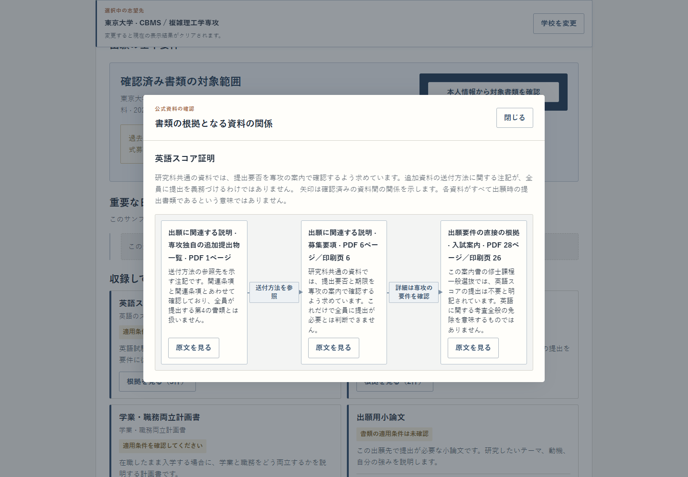
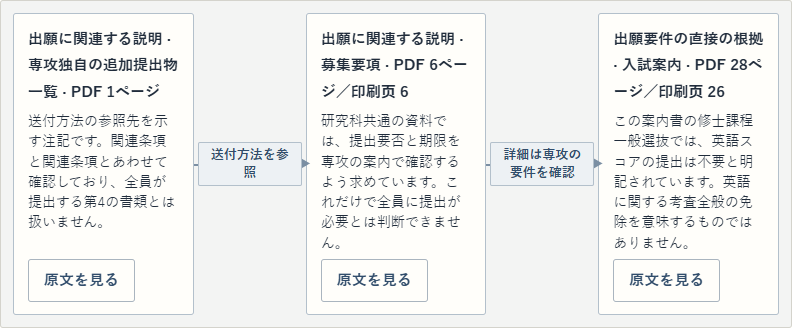
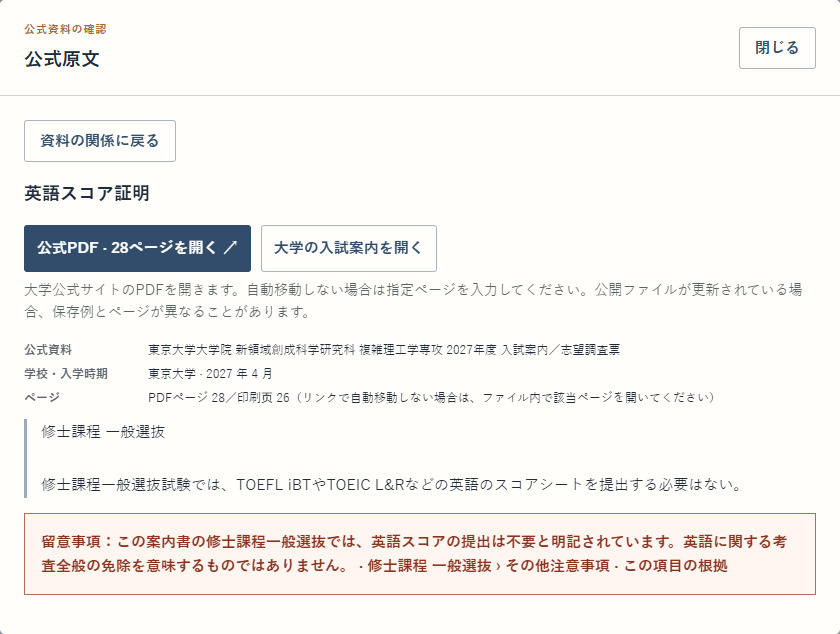
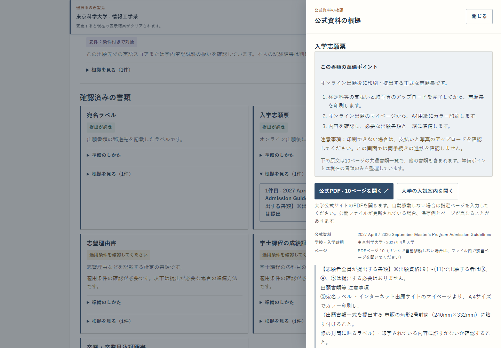
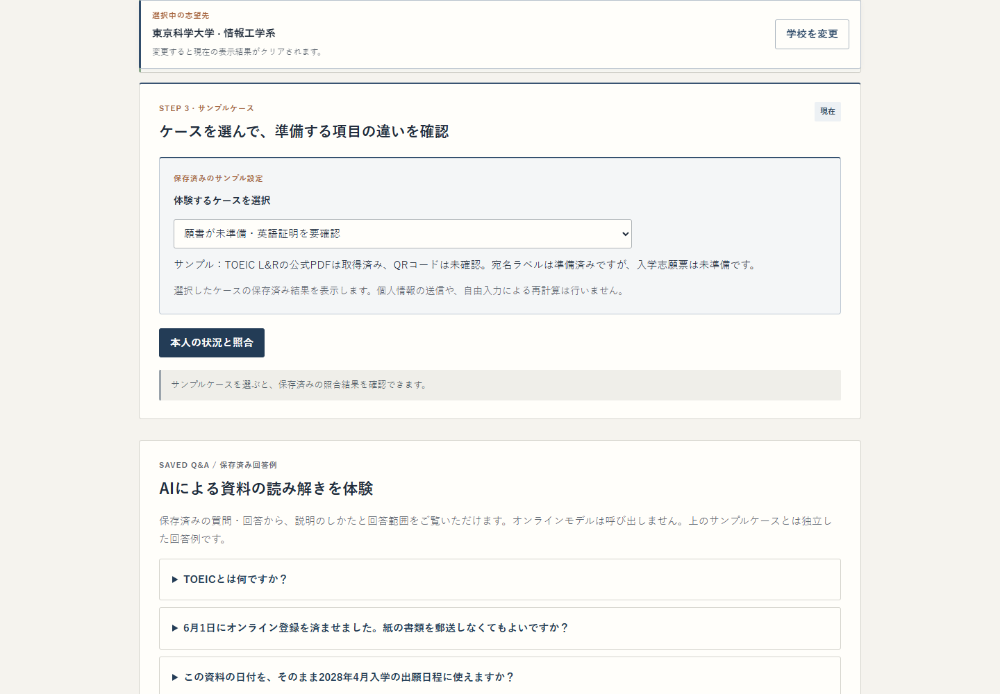
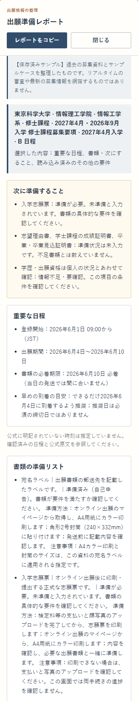
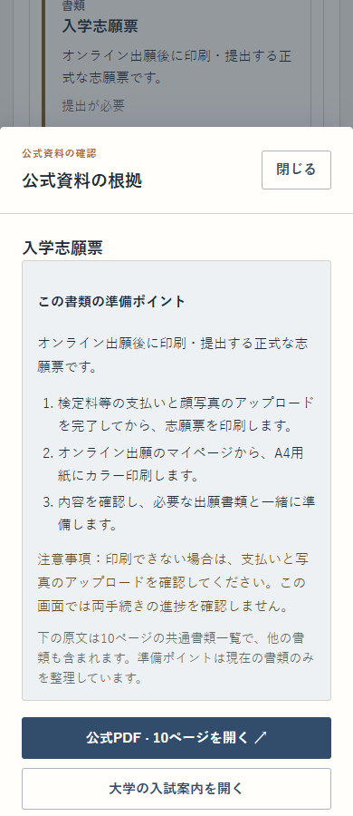

# 公開デモの操作画面：根拠・準備・レポート

[READMEへ戻る](../../README.md) · [公開デモを操作する](https://yasu-isct.github.io/J-Grad-Admission-RAG/) · [前回の画面と検証記録](screenshots-ja.md)

公開デモの日本語画面で、資料の関係から原文への往復、基本要件から準備状況への移動、スマートフォンでのレポート閲覧を撮影しました。表示内容は過去の募集資料と本人情報の保存済みサンプルです。

撮影対象の公開配信（`gh-pages`）コミット：`112211e28f46bcbb7882be01bce0fc4d7eb7a068`。文書を管理する `main` のコミットとは区別しています。デスクトップの視口は1440×1000、スマートフォンの視口は390×900です。局部画像は画面の一部を切り出しています。

[撮影対象・操作・画像の記録](../assets/portfolio/public-demo-2/capture-manifest.json) · [既存の撮影スクリプトを拡張した再撮影用スクリプト](../assets/portfolio/public-demo-2/capture-public-demo.py)

画像9枚と無音動画1本で合計2.16MBです。PNGは最大228,486 bytes、動画は10.2秒・978,082 bytesで、各400KB／3MBの上限内に収めています。動画はPlaywrightが保存した元ファイルのままで、編集・再エンコードしていません。

## A — 資料の関係から原文を確認し、戻る

東京大学・新領域創成科学研究科・複雑理工学専攻の `working` ケースです。矢印は資料間の参照・補足関係を示し、三つの資料をすべて提出するという意味ではありません。



英語スコア証明の根拠となる募集要項・入試案内・追加提出物一覧を、資料の役割とともに確認する画面です。

公開デモの操作画面。保存済みサンプルの再生です。撮影：2026-10-25。



各資料のカード、関係を示す矢印、原文を開くボタンを切り出しています。

公開デモの操作画面。保存済みサンプルの再生です。撮影：2026-10-25。



関係図のカードから開いた入試案内のPDF28ページに対応する原文と、出典のページ情報を確認できます。

公開デモの操作画面。保存済みサンプルの再生です。撮影：2026-10-25。


原文の「資料の関係に戻る」から、同じ資料の関係図へ戻った状態です。

公開デモの操作画面。保存済みサンプルの再生です。撮影：2026-10-25。

[操作動画を手動で再生する（WebM）](../assets/portfolio/public-demo-2/a-evidence-walkthrough.webm)

資料の関係から原文を開いて戻る操作を、後処理なしで録画しています（自動再生はしません）。

公開デモの操作画面。保存済みサンプルの再生です。撮影：2026-10-25。

## B — 基本要件から、次に準備することへ

東京科学大学・情報工学系の `materials` ケースです。準備状況はサンプルの自己申告に基づくもので、書類の提出済み・大学での受理を意味しません。

「本人の状況と照合」を押す前後の2画面に、確認元の原文画面を添えています。作品紹介では元画像をそのまま切り替えたり、3枚を並べたりできます。



第2ステップの基本要件から「入学志願票」の原文を開き、準備の根拠となる公式資料を確認します。

公開デモの操作画面。保存済みサンプルの再生です。撮影：2026-10-25。



第3ステップで固定されたサンプルケースの本人情報と確認ボタンを表示し、準備状況を確認する操作へ進みます。

公開デモの操作画面。保存済みサンプルの再生です。撮影：2026-10-25。


第4ステップでは、準備・対応が必要な項目と確認が必要な項目を整理して表示します。

公開デモの操作画面。保存済みサンプルの再生です。撮影：2026-10-25。

## C — スマートフォンでレポートを読み、原文を確認する

同じ東京科学大学の `materials` ケースを、390×900の視口で撮影しています。レポート内に原文ボタンはなく、原文を確認するときはレポートを閉じて第4ステップに戻ります。



レポート内を連続してスクロールし、「保存済みサンプル」の注記から書類の準備リストの最初の2項目までを、拡大・縮小せず元の画素でつないだ抜粋です（全文ではありません）。

視口は390×900のまま、対話枠外の背景を切り出し対象から除いた画像は366×1841です。各スクロール位置・撮影時刻はmanifestに記録しています。

公開デモの操作画面。保存済みサンプルの再生です。撮影：2026-10-25。



レポートを閉じ、第4ステップの「入学志願票」から原文参照ウィンドウを開き、準備ポイントと公式PDFへの入口を表示しています。

公開デモの操作画面。保存済みサンプルの再生です。撮影：2026-10-25。

<details>
<summary>再撮影する場合</summary>

既存の `capture-editorial.py` の操作順と撮影ヘルパーを拡張し、公開URL専用・出力先分離のスクリプトとして保存しています。Playwright、Pillow、Edge/Chromium、PlaywrightのFFmpegを使用します。モデルや製品バックエンドは不要です。

`--public-commit` は取得済みの `gh-pages` コミットを指定してください。読み込んだ公開ファイルのSHA-256がそのGitオブジェクトと一致しなければ、その経路は不成功として記録されます。

```text
python docs/assets/portfolio/public-demo-2/capture-public-demo.py --repo . --output outputs/new-captures --audit-dir outputs/new-capture-audit --public-commit 112211e28f46bcbb7882be01bce0fc4d7eb7a068 --ffmpeg /path/to/ffmpeg
```

動画を撮るときは `PLAYWRIGHT_BROWSERS_PATH` を録画用FFmpegがあるPlaywrightツールディレクトリに合わせてください。既存画像がある出力先は使用できません。外部PDFは開かず、公開デモ内の原文表示と公式PDFへのリンクまでを撮影します。

</details>
