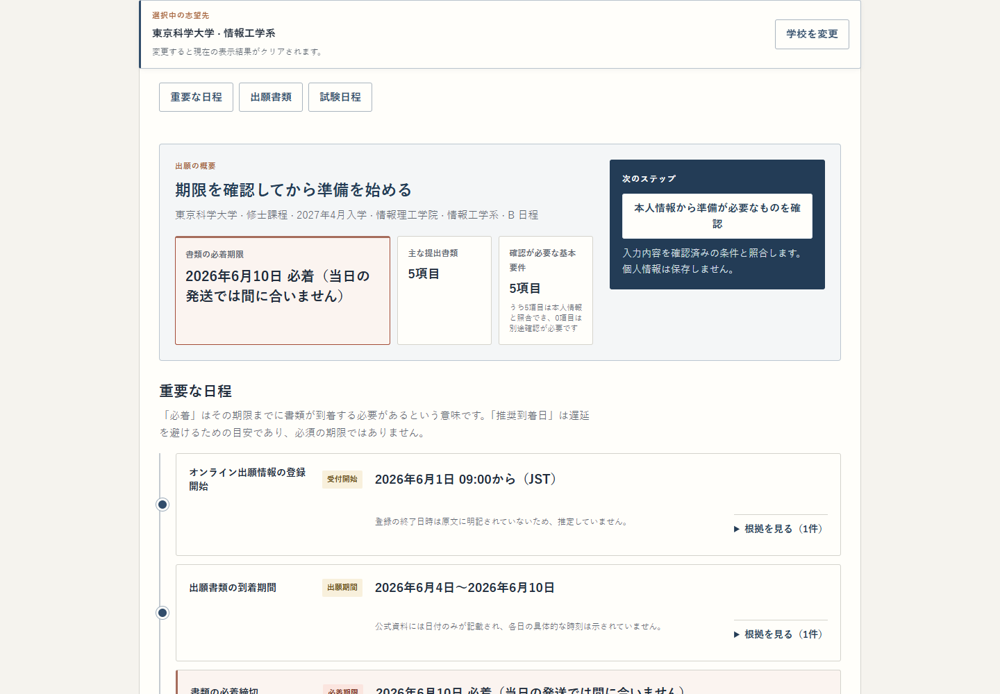
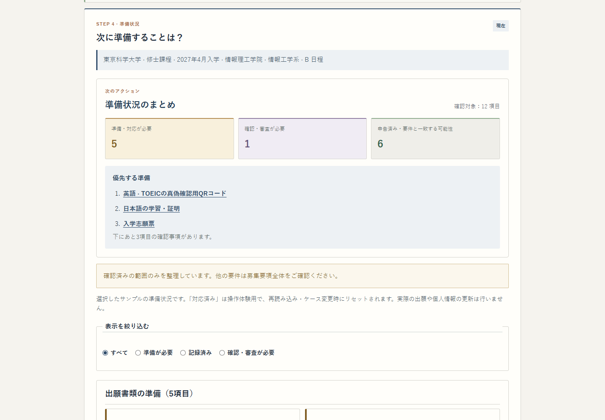
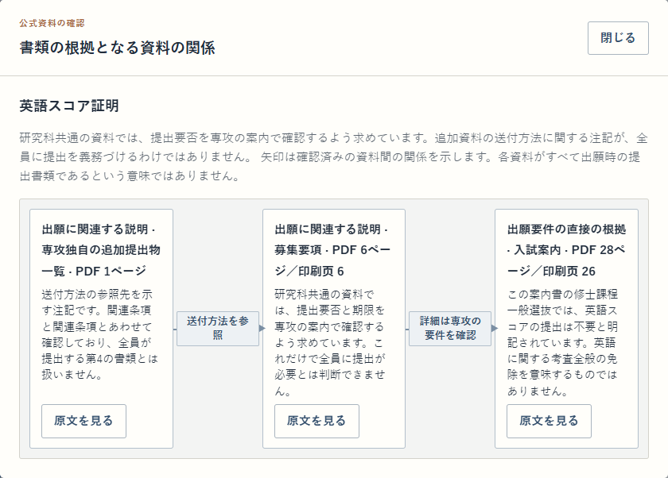
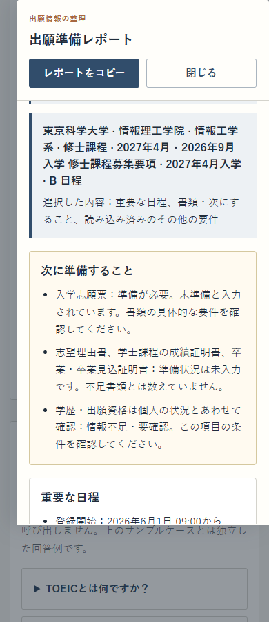
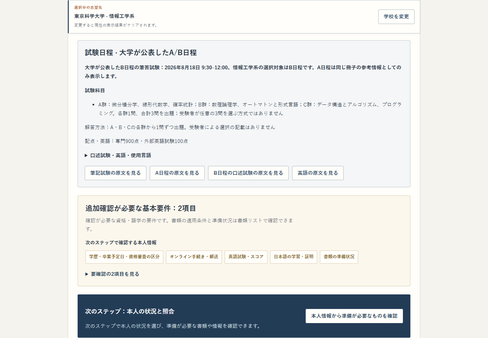

# デモ画面と検証記録

[READMEへ戻る](../../README.md) · [公開デモを操作する](https://yasu-isct.github.io/J-Grad-Admission-RAG/)

以下は公開静的デモの日本語画面を、ブラウザで実際に操作して撮影した画像です。2026年10月21日に、暖白・墨藍の配色、細い区切り線、紹介ページの明朝体見出しに更新しました。操作画面は読みやすいゴシック体を使用します。二校四ステップと日本語・中国語切替は既存機能を再利用しています。

保存済みサンプルの表示・操作を確認したもので、新しい実HTTPによる資格照合・RAG検索・生成APIの受入試験ではありません。画面中の日付は固定した過去の資料、本人情報はテスト入力です。

配信コミット：`e2759513c29988a333de8be17ce8c0cc88fcb21e`。デスクトップは1440×1000、スマートフォンは390×900。一部の画像は実際のダイアログ要素の範囲を撮影しています。[撮影対象と視口](../assets/portfolio/public-demo/capture-manifest.json) · [操作の検証記録](public-demo-validation.json)

## 01 — 日程・書類を読み取る

東京科学大学・情報工学系・2027年4月入学・B日程、`materials` の保存ケース。日程や共通書類を項目ごとに確認できます。

## 02 — 準備状況から次の行動を知る

同じケースの第四ステップ。未準備、確認が必要な事項、本人が申告した準備状況を分けています。準備済みの自己申告は、学校の受理や資格確定を意味しません。

## 03 — 三つの資料の役割を確認する

東京大学・新領域創成科学研究科・複雑理工学専攻、`working` の保存ケース。英語スコア証明の扱いについて、共通要項・専攻案内・追加提出物一覧をつなぎます。矢印は確認済みの参照・補足関係であり、全資料を提出するという意味ではありません。原文とページは各カードから確認できます。

## 04 — スマートフォンで情報を持ち帰る

東京科学大学の `materials` ケース。レポート内をスクロールして志望先と次の準備事項を表示した画面です。実際のプレビューとコピーを確認しました。保存済みサンプルの注記はレポートとコピー文に残ります。

## 05 — 試験情報を項目ごとに確認する

公開デモで使う情報工学系のB日程。科目範囲、日程、配点、原文入口を表示します。本体の18系対応とは範囲が異なり、静的デモの東京科学大学はこの一つの対象を収録しています。

## 今回確認したこと

- 日本語・中国語の5ケース×デスクトップ/スマートフォン、20ケースの操作とレポートコピー。
- 根拠から原文への往復、学校変更、両方向の言語切替。切替後も学校とケースを引き継ぎ、第一ステップを開きます。
- 34個の保存データ・実行コード・基礎スタイルのハッシュは前版と一致。今回の変更は専用CSS、紹介文の見出し、展示画像と記録です。
- 製品POST、生成API、モデル・PDFのダウンロード、KB/索引構築は0。M13バックエンド配備は停止を継続します。

## 元の実装と過去の検証

以下の元画像・記録は上書きしていません。本ページの新しい静的デモ画像と区別して保持します。

- [M19開発時の実HTTPブラウザ記録](../onboarding/m19-evidence/live-browser-journal.json) / [元の志望調査票の関係図](../onboarding/m19-evidence/desktop-application-questionnaire-relations.png)
- [M19設計側の保存実レスポンス再生](../onboarding/m19-design-evidence/five-topic-replay/replay-browser-journal.json) / [元の準備手順](../onboarding/m19-design-evidence/five-topic-replay/desktop-application-questionnaire-guide.png)
- [EXAM-02の受入記録](../onboarding/exam02-design-acceptance.md) / [元のシステム制御系表示](../onboarding/exam02b-evidence/review-system-control-1440-card.png)

画像は利用者数、商用運用、全質問への正確性を証明するものではありません。公開QAは過去のテストから選んだ保存回答で、日本語版は翻訳です。新しい生成評価は行っていません。
